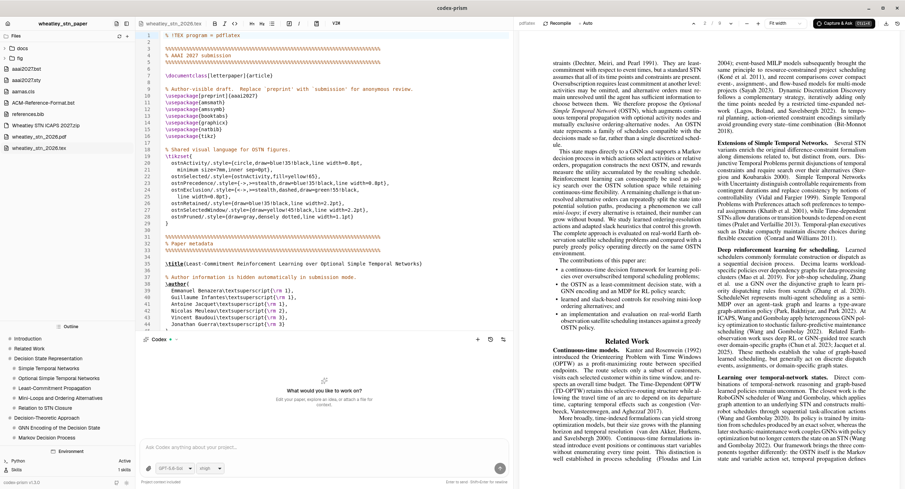

<h1 align="center">
  
  codex-prism
</h1>

<p align="center"><strong>Write papers, slides, and reports with parallel Codex chats, LaTeX, and PDF review.</strong></p>

Work on several parts of a document at once, review the results, and keep the changes you want. codex-prism brings your local files, AI conversations, compiled PDF, and Git history into one desktop workspace.

[Download](https://github.com/beniz/codex-prism/releases/latest) · [Quickstart](#quickstart) · [Features](#features) · [Technical reference](README_AGENTS.md)

## Quickstart

**[Download the latest release](https://github.com/beniz/codex-prism/releases/latest)** and choose your platform:

| Platform | Download | Install |
| --- | --- | --- |
| Linux x86_64 | `.deb` or `.AppImage` | Ubuntu 26.04 LTS packages; commands below. Older distributions are not guaranteed to work. |
| macOS Apple Silicon | `.dmg` | Open it and drag codex-prism into Applications. |
| Windows 10/11 x64 | `-setup.exe` | Run the installer, then launch from the Start menu. |

Packaged builds need no Node.js or Rust development toolchain. Windows installers are unsigned; macOS builds are ad-hoc signed, not notarized. On macOS, approve a blocked first launch through **System Settings → Privacy & Security → Open Anyway**.

### Linux

From your download folder, replace `VERSION` with the downloaded filename's version:

```sh
sudo apt install ./codex-prism-VERSION-linux-x86_64.deb
sudo apt install texlive-latex-extra texlive-publishers texlive-fonts-recommended \
  texlive-xetex texlive-luatex texlive-bibtex-extra biber
```

If Codex is not already installed, use the [official CLI installer](https://developers.openai.com/codex/cli):

```sh
curl -fsSL https://chatgpt.com/codex/install.sh | sh
```

Prefer a portable package? See [AppImage instructions](README_AGENTS.md#linux-installation).

### macOS

If Codex and TeX are missing, install them with [Homebrew](https://brew.sh/) using the [Codex](https://developers.openai.com/codex/cli) and [MacTeX](https://formulae.brew.sh/cask/mactex-no-gui) packages:

```sh
brew install --cask codex mactex-no-gui
```

Reopen your terminal and relaunch codex-prism after installation. Existing Codex and TeX installations can be reused.

### Windows

The installer reuses existing tools and installs missing Codex, MiKTeX, and WebView2. Missing prerequisites require internet access and Windows App Installer (`winget`). Existing tools are not upgraded. [Windows setup details](docs/releases/windows.md)

### Start writing

1. Open codex-prism and select **Connection → Sign in**.
2. Open a LaTeX project, or create one from a template.
3. Ask for an edit, inspect the PDF, then choose **Keep** or **Discard changes**.

Python environments and scientific skills are optional. You can configure them later.

## Features

| What makes it useful | What you can do |
| --- | --- |
| **Parallel chats for one document** | Draft the introduction, refine figures, and revise conclusions at the same time. Each chat has its own proposal and PDF preview. |
| **Automatic merging on Keep** | Merge a chat's changes into the latest main document. Earlier accepted work is preserved; conflicting edits are reported for repair. |
| **Git-collaborative writing** | Keep creates an ordinary Git commit with a shortened prompt title and a summary of accepted changes. Optionally include full prompts; inspect or restore earlier versions in History. |
| **Private templates** | Reuse your conference papers, slide decks, theses, and technical reports—with bibliography, styles, logos, figures, and writing instructions. |
| **Per-document data sources** | Share files, local directories, and remote directories across the project's chats. Delegate research to existing Codex servers on other machines through SSH, without mounting remote filesystems. |
| **Shared project instructions** | Set the document's purpose, audience, and standing guidance once. Every chat receives them on its next turn. |

This README describes the current `main` branch. See the [release notes](https://github.com/beniz/codex-prism/releases/latest) for packaged versions and the [changelog](CHANGELOG.md) for recent changes.

## See the workflow



*Workspace overview from an earlier version; controls and shortcuts have evolved.*

**You choose when work joins the document.** Keep accepts one chat's whole proposal. Pending chats retain their own versions; chats without pending work show the latest main PDF. A follow-up refines its existing proposal. Manual LaTeX editing unlocks when running work and pending proposals are resolved.

Try separate chats with focused requests:

```text
Chat A: Shorten the introduction.
Preserve the research question and citations.

Chat B: Improve the results figure captions.
Keep the reported values unchanged.

Chat C: Draft a limitations slide using @attachments:/paper.pdf.
Cite the source pages.
```

For the third example, add the paper in project settings first, then type `@` and press Tab to choose its registered reference.

## Everyday tools

- **LaTeX and PDF together:** syntax highlighting, search, auto-save, multi-file projects, zoom, text selection, and source/PDF navigation. Hide the code when you want to focus on writing.
- **Local compilation:** TeX Live or MiKTeX, with pdfLaTeX, XeLaTeX, LuaLaTeX, BibTeX, and Biber. Optional Auto recompilation and conservative incremental builds.
- **Plan, then edit:** native Codex Plan mode, per-project model/effort preferences, tool approvals, and conversations retained across restarts.
- **PDF export:** original quality, high quality (300 dpi), or compact (150 dpi). Optimized export uses Ghostscript and leaves the working PDF unchanged.
- **Optional research tools:** project Python environments through [uv](https://docs.astral.sh/uv/), writing guidance, and [scientific skills](https://github.com/K-Dense-AI/claude-scientific-skills).
- **Desktop conveniences:** project folders, external editor integration, and light/dark themes.

| To… | Do this |
| --- | --- |
| Set shared instructions or rename a project | Click the project title. |
| Add research material | Project settings → Data sources → Add files / Add directory / Add SSH connection. |
| Reference a registered source | Type `@`, then Tab; use arrows and Tab/Enter to choose, Escape to close. |
| Reuse your own starter | Put it in `~/.codexprism/templates/`, then open **My Templates → Refresh**. [Template guide](README_AGENTS.md#private-templates) |
| Navigate the document | Click an outline heading, double-click a LaTeX line, or select PDF text and choose **Navigate to source**. |
| Hide the LaTeX panel | Toggle **Code** beside **Layout**. |
| Plan before editing | Press Shift+Tab in an idle chat composer. |
| Reuse a prompt | Press Up in an empty composer; Down returns through history. |
| Save a manual recovery point | History → Save checkpoint. |

### Data-source references

| Reference | Meaning |
|---|---|
| `@research:` | Use the entire registered source |
| `@research:/` | Equivalent explicit root |
| `@research:/reports/` | Use this subdirectory |
| `@research:/reports/results.pdf` | Use this file |
| `@attachments:` | Use all registered files in that group |

## Your files and privacy

Projects and document compilation stay local. Git history is shared with the configured remote only when collaboration is connected. Codex sends prompts and the content it uses to its configured AI provider. Its installed CLI manages the account and credentials.

Git commit titles can contain shortened prompts. **Include prompt in commits** adds full user prompts and is off by default. Review history before sharing it; connected projects automatically push explicit Save checkpoints and changes accepted with Keep. Autosave remains local.

Remote data sources need an already running, authenticated Codex server. Remote agents are instructed to leave sources unchanged; this is **instruction-based protection**, not a filesystem read-only guarantee. [SSH setup and limits](README_AGENTS.md#ssh-data-sources)

codex-prism supports asynchronous Git collaboration through GitHub and Gitea. Use **Connect shared project** from the project picker or workspace; **Request review** prepares findings and suggested edits on a local branch. It does not provide simultaneous live editing. See [collaboration setup](docs/collaboration.md).

## Troubleshooting

| Problem | First step |
| --- | --- |
| Codex is not found | Set its full executable path in **Connection**, then restart the app. |
| The PDF will not compile | Check the error for missing TeX packages, fonts, or a required engine. [Compilation guide](README_AGENTS.md#latex-compilation) |
| Keep reports a conflict | Use **Fix with agent**, review the repaired proposal, then Keep again. Main stays unchanged until a clean acceptance. |
| A remote source is unavailable | Check SSH access and the existing server, then **Test connection**. [Remote setup](README_AGENTS.md#ssh-data-sources) |
| You want to update the app | Download and install the latest package; updates are manual. Release assets include checksums. |

For help, [open an issue](https://github.com/beniz/codex-prism/issues) with your OS, app version, and relevant error message.

## Build from source

After installing the [development prerequisites](README_AGENTS.md#build-from-source):

```sh
git clone https://github.com/beniz/codex-prism.git
cd codex-prism
corepack pnpm install --frozen-lockfile
corepack pnpm dev:desktop
```

The default launcher disables automatic reloads; relaunch to apply code changes. See [CONTRIBUTING.md](CONTRIBUTING.md) to contribute, or [README_AGENTS.md](README_AGENTS.md) for detailed setup, architecture, tests, and releases. Coding agents should start with [AGENTS.md](AGENTS.md).

## License

[MIT](LICENSE)

## Acknowledgments

Forked from [ClaudePrism](https://github.com/delibae/claude-prism) by delibae, adapted to use Codex. ClaudePrism started from [Open Prism](https://github.com/assistant-ui/open-prism) by [assistant-ui](https://assistant-ui.com/).
